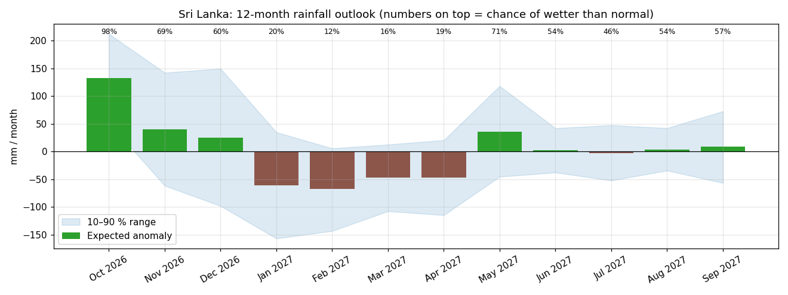
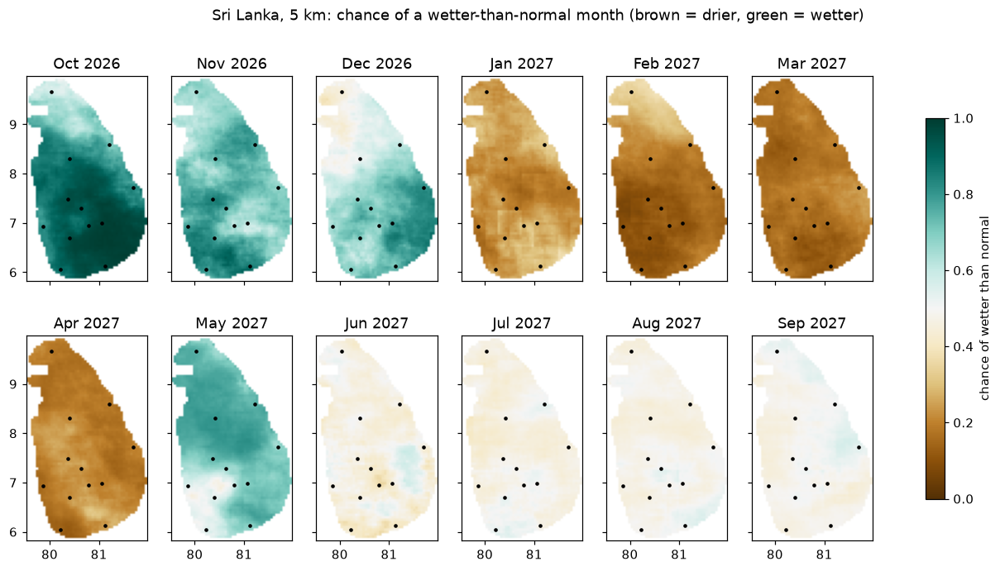
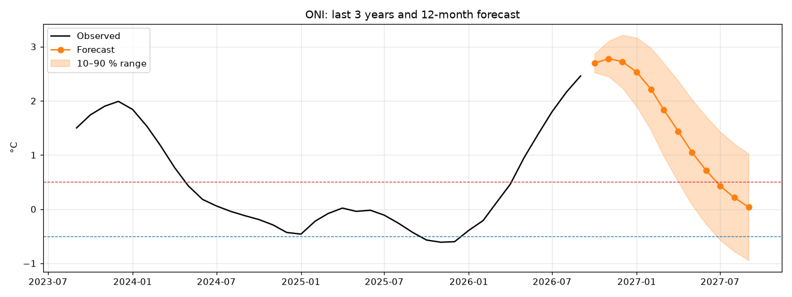
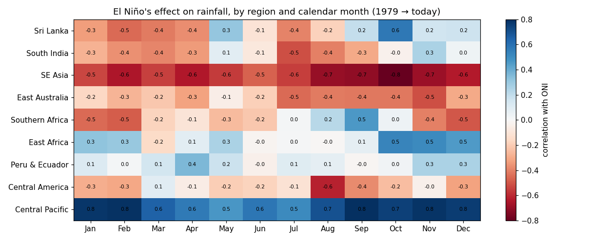
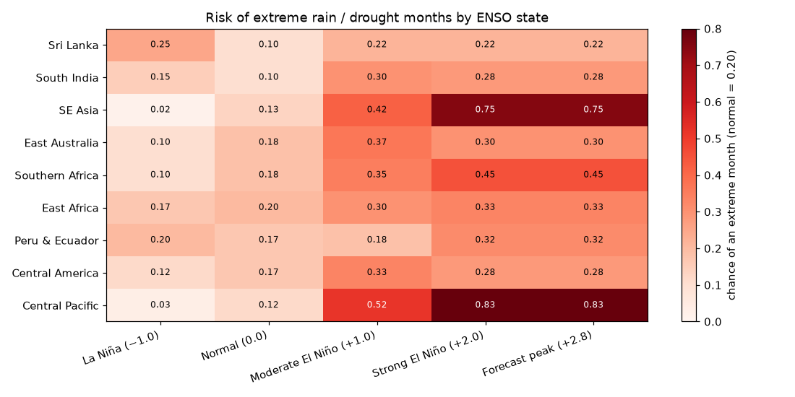
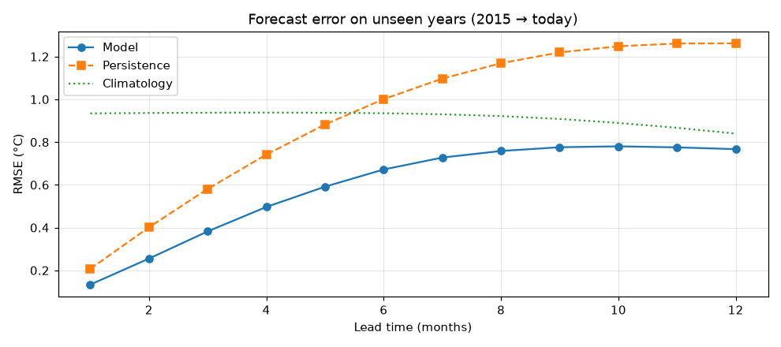

# El Niño & Sri Lanka Rainfall — 12-Month Forecast

A single Jupyter notebook that downloads **real NOAA climate data**, forecasts the
**Oceanic Niño Index (ONI)** up to 12 months ahead, and turns it into a
**month-by-month rainfall outlook for Sri Lanka**.

<!-- results:start -->
## Results

*Data through **Sep 2026**. Updated 2026-11-13. This is a machine-learning forecast, not an
official one. Check NOAA CPC, IRI or the Sri Lanka Department of Meteorology before acting on it.*

### In short

- **El Niño is happening now.** The ONI (central-Pacific sea temperature anomaly) is
  **+2.46 °C** in Sep 2026. The highest value since 1979 is +2.59 °C (Dec 2015).
- **The forecast:** El Niño peaks at about **+2.78 °C around Nov 2026**
  and weakens to about +0.04 °C by Sep 2027.
- **Sri Lanka:** wetter than normal in **Oct 2026, Nov 2026, Dec 2026, May 2027**. Drier than normal in **Jan 2027, Feb 2027, Mar 2027, Apr 2027**.
- **Accuracy:** on years the model never saw (2015 to today), its error is **35% smaller** than
  simply assuming "no change".

### Sri Lanka rainfall, next 12 months



"Expected" is the difference from the normal rainfall for that month (1991–2020 average).

| Month | Outlook | Expected | Likely range (10–90 %) | Chance of wetter than normal |
|---|---|---:|---:|---:|
| Oct 2026 | 🌧️ wetter | +133 mm | +52 to +212 mm | 98% |
| Nov 2026 | 🌧️ wetter | +40 mm | −62 to +142 mm | 69% |
| Dec 2026 | 🌧️ wetter | +25 mm | −98 to +150 mm | 60% |
| Jan 2027 | ☀️ drier | −61 mm | −157 to +35 mm | 20% |
| Feb 2027 | ☀️ drier | −68 mm | −143 to +6 mm | 12% |
| Mar 2027 | ☀️ drier | −47 mm | −108 to +13 mm | 16% |
| Apr 2027 | ☀️ drier | −47 mm | −115 to +21 mm | 18% |
| May 2027 | 🌧️ wetter | +36 mm | −45 to +118 mm | 71% |
| Jun 2027 | ➖ near normal | +3 mm | −38 to +42 mm | 54% |
| Jul 2027 | ➖ near normal | −3 mm | −52 to +48 mm | 46% |
| Aug 2027 | ➖ near normal | +4 mm | −34 to +42 mm | 55% |
| Sep 2027 | ➖ near normal | +8 mm | −57 to +73 mm | 57% |

### Town by town (5 km CHIRPS rainfall)



Green means a wetter-than-normal month is likely, and brown means drier. The table shows the expected
difference from normal rainfall in mm per month.

| Town | Oct 26 | Nov 26 | Dec 26 | Jan 27 | Feb 27 | Mar 27 | Apr 27 | May 27 | Jun 27 | Jul 27 | Aug 27 | Sep 27 |
|---|---:|---:|---:|---:|---:|---:|---:|---:|---:|---:|---:|---:|
| Jaffna | +26 | +62 | −26 | −55 | −45 | −44 | −52 | +56 | −1 | −2 | −3 | +1 |
| Trincomalee | +64 | +107 | +51 | −62 | −105 | −46 | −46 | +40 | −2 | +3 | −5 | 0 |
| Anuradhapura | +110 | +46 | +8 | −63 | −59 | −55 | −56 | +82 | −1 | −2 | −3 | −3 |
| Batticaloa | +74 | +69 | +189 | −161 | −147 | −50 | −41 | +9 | −1 | −3 | −1 | +6 |
| Kurunegala | +178 | +99 | +47 | −62 | −73 | −78 | −75 | +79 | −6 | −4 | −3 | −2 |
| Kandy | +151 | +74 | +67 | −101 | −82 | −68 | −64 | +52 | −17 | −4 | +2 | +1 |
| Colombo | +117 | +84 | +36 | −50 | −69 | −79 | −118 | +18 | −4 | −7 | −6 | −7 |
| Badulla | +168 | +35 | +102 | −100 | −109 | −81 | −77 | +33 | −4 | +1 | 0 | −2 |
| Nuwara Eliya | +125 | +29 | +57 | −58 | −71 | −60 | −58 | +19 | −23 | −2 | −1 | −2 |
| Ratnapura | +238 | +82 | +55 | −56 | −103 | −110 | −110 | +18 | −19 | +2 | −14 | +3 |
| Hambantota | +125 | +76 | +42 | −34 | −44 | −63 | −35 | +30 | −6 | −1 | +1 | −4 |
| Galle | +183 | +75 | +44 | −48 | −67 | −63 | −132 | +13 | −22 | +3 | −3 | −19 |

### El Niño forecast



Above **+0.5 °C** is El Niño, and below **−0.5 °C** is La Niña. The shaded band shows the likely range.

### Why Sri Lanka is forecast month by month



Blue means El Niño brings **more** rain that month, and red means **less**. For Sri Lanka the effect
flips with the season: more rain around **October**, less from **January to April**. So the old rule
"El Niño = drought" is wrong for Sri Lanka.

### Which regions are most at risk



The numbers show the chance of an extreme (1-in-5) dry or wet month. The normal chance is **0.20**.
At the forecast peak:

- Very high risk: Central Pacific (0.83), SE Asia (0.75)
- High risk: Southern Africa (0.45)
- Sri Lanka: 0.22. Over a whole year Sri Lanka's wet and dry effects balance out,
  so the month-by-month table above gives more information.

### How good is the model?



Lower error is better. The model (blue) beats both simple guesses at every lead time from 1 to 12 months.

<!-- results:end -->

## Run it

1. Open [Google Colab](https://colab.research.google.com) → *File → Upload notebook* → `enso_sri_lanka_forecast.ipynb`
2. *Runtime → Run all* (a few minutes, no GPU needed)
3. Download `results.zip` from the Files panel

The first run downloads ~180 MB of data into `real_data/`.

The 5 km step reads `data/chirps_sri_lanka.nc`. On Colab the notebook fetches it from this GitHub
repository. If the repository is private, upload that file into a `data/` folder in Colab first.

Running it locally works too: `pip install numpy pandas xarray netCDF4 scipy scikit-learn matplotlib jupyter`.

## Results page

Open `docs/index.html` in a browser to see the latest results as a readable page
(charts + tables, light/dark mode). All data is inside the file; the charts need an internet connection.

To update it after a new notebook run, put the new `results.zip` in `output/` and run:

```bash
python3 make_site.py            # or: python3 make_site.py path/to/results.zip
```

## What it does

| Step | Output |
|---|---|
| Download ONI, SOI, OLR, Pacific SST and rainfall, 1979 → today | `monthly_dataset.csv` |
| How El Niño changes rain in 9 regions, per calendar month | `2_rain_vs_oni_by_month.png` |
| Ridge-regression ONI forecast for leads 1–12 months, tested on 2015 → today against persistence and climatology | `3_forecast_skill.png`, `forecast_skill.csv` |
| 12-month ONI forecast with 10–90 % range and El Niño / La Niña probability | `4_oni_forecast.png`, `oni_forecast.csv` |
| Sri Lanka rainfall outlook (per-month ONI → rain relationship, Monte Carlo uncertainty) | `5_sri_lanka_rain_outlook.png`, `sri_lanka_rain_outlook.csv` |
| The same outlook on a 5 km grid and for 12 towns (CHIRPS) | `7_sri_lanka_map.png`, `sri_lanka_towns_rain_mm.csv`, `sri_lanka_towns_chance_wetter.csv` |
| Chance of an extreme rain/drought month per region and ENSO state | `6_regional_risk.png`, `regional_risk.csv` |

## Key finding

El Niño does **not** simply mean drought for Sri Lanka. Rainfall rises in
**October–November** and falls in **January–April** during El Niño, so the outlook is
computed month by month.

## Data sources

All data are free and public, from NOAA:

- **ONI, SOI, OLR** — NOAA Climate Prediction Center, <https://www.cpc.ncep.noaa.gov/data/indices/>
- **ERSST v5** sea-surface temperature — Huang et al. (2017), NOAA PSL
- **GPCP v2.3** monthly precipitation — Adler et al. (2018), NOAA PSL
- **CHIRPS v3.0** monthly precipitation, 0.05° — Climate Hazards Center, UC Santa Barbara.
  The Sri Lanka part (1981–2025) is stored in `data/chirps_sri_lanka.nc` (4.7 MB).

## Limitations

- The ONI model is linear and simple. Compare with official forecasts (NOAA CPC, IRI, ECMWF) before relying on it.
- GPCP's 2.5° grid gives only ~2 grid cells over Sri Lanka. The 5 km CHIRPS map and town table add
  local detail, but each pixel's fit uses only ~43 values per month: read them for patterns, not exact amounts.
- `data/chirps_sri_lanka.nc` has no 1987 and 2003: the CHIRPS server blocked the download.
- Only a handful of strong El Niño events exist since 1979, so strong-event estimates are uncertain.
